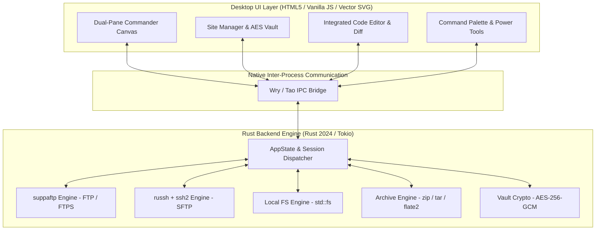

# 90FTP — Modern Site Manager & Cloud File Commander

<div align="center">


### High-Performance Desktop SFTP / FTP / FTPS Client & Remote DevOps Commander

[](https://github.com/aljupcom/90FTP/releases/latest)
[](https://github.com/aljupcom/90FTP/releases)
[](https://github.com/aljupcom/90FTP/releases/latest)
[](https://www.rust-lang.org/)
[](https://github.com/aljupcom/90FTP)
[](https://github.com/aljupcom/90FTP)

<br/>

[⬇️ **Download Latest Windows Installer (.exe)**](https://github.com/aljupcom/90FTP/releases/latest) &nbsp;&bull;&nbsp;
[📦 **View Release History**](https://github.com/aljupcom/90FTP/releases) &nbsp;&bull;&nbsp;
[🐛 **Report an Issue**](https://github.com/aljupcom/90FTP/issues) &nbsp;&bull;&nbsp;
[⭐ **Star on GitHub**](https://github.com/aljupcom/90FTP)

</div>

---

## ⚡ Overview

**90FTP** is a next-generation desktop file transfer client and server management workstation engineered in **Rust**. Built for systems administrators, DevOps engineers, and full-stack web developers, it combines the dual-pane workflow of **WinSCP** and **Total Commander** with modern aesthetics, hardware-accelerated rendering, and cloud-native server diagnostic tools.

Unlike heavyweight Electron-based clients that consume hundreds of megabytes of memory, 90FTP runs on a lean, native **Rust (`tao` + `wry` WebView2)** architecture. It launches instantaneously, consumes ~50MB of RAM, and delivers raw transfer speeds backed by pure async I/O.

---

## 🌟 Key Features

### 🗂️ 1. Advanced Dual-Pane Commander
- **Dual-Pane Interface**: Independent local PC and remote server explorers with path breadcrumbs, drive switchers (`C:\`, `D:\`), and parent directory navigation.
- **Multi-Tab Strip**: Open multiple concurrent server directories or local workspaces in browser-style tabs.
- **Synchronized Browsing (`Ctrl + Y`)**: Lock-step navigation mirrors directory changes between local and remote panes automatically.
- **Hierarchical Path Tree & History**: One-click jump to parent directories, deep folder hierarchies, and recent navigation history.
- **Instant Quick Filter (`Ctrl + I`)**: Real-time client-side item filtering by name or extension in both panes.
- **Total Commander Function Keys**: `F2` Rename, `F4` Edit, `F5` Transfer, `F6` Interactive Move/Copy, `F7` New Folder, and `F8` Delete.

### 🔐 2. Enterprise Protocols & AES-256-GCM Vault
- **Supported Protocols**:
  - **SFTP (SSH File Transfer Protocol)**: High-speed secure transfers via pure async `russh` and native `ssh2` engines.
  - **FTP**: Standard RFC 959 File Transfer Protocol.
  - **FTPS**: Explicit TLS/SSL encryption for legacy servers requiring strict cryptographic compliance.
- **Encrypted Credential Vault**: Zero plaintext passwords on disk. Host profiles, keys, and passphrases are stored in local secure storage encrypted with **AES-256-GCM**.
- **Interactive Site Manager**: Quick-select server profiles, inline connection reachability testing, password visibility toggles, and protocol badges.

### 🛠️ 3. Integrated Power Tools & Server Diagnostics
- **Omni Command Palette (`Ctrl + K` / `Ctrl + P`)**: Spotlight-style command launcher to trigger tools, switch saved servers, jump to bookmarks, or locate files in seconds.
- **Full-Text Content Grep (`Ctrl + Shift + F`)**: Search regex and code patterns inside files across remote server directory trees and local workspaces.
- **Batch Multi-Rename Engine (`Ctrl + M`)**: Total Commander style batch file renamer with regex find/replace, prefix/suffix insertion, case conversion, and sequential `[N]` counters with zero-padding.
- **Side-by-Side File Content Diff**: Compare local and remote files with visual line diffs, syntax-aware change highlighting, and difference counts.
- **Remote Server Health & Disk Analyzer**: Real-time CPU load averages, physical RAM usage meters, and mount point disk utilization.
- **Remote Process, Port & Systemd Service Manager**: Inspect server processes (PID, User, CPU%, MEM%), examine listening TCP/UDP sockets, and restart/reload systemd services directly from the GUI.
- **SSH Keypair Generator & 1-Click Deployment**: Generate modern **Ed25519** and **RSA** keypairs in the local vault and deploy public keys to remote `~/.ssh/authorized_keys` with one click.
- **Network Ping, TCP Port Probe & Banner Inspector**: Measure DNS resolution time, TCP handshake RTT latency, packet jitter, and inspect service greeting banners.
- **Live Tail & Binary Hex Inspector**: Stream growing server log files in real-time (`tail -f` mode) with error highlighting or inspect binary structures in hexadecimal.

### 🚀 4. Smart File Transfers & Archive Engine
- **Server-Side Archive Compression & Extraction**: Compress or extract `.zip`, `.tar.gz`, `.tar.bz2`, `.tar.xz`, and `.tar` archives directly on remote servers without downloading gigabytes of source files first.
- **Transfer Exclusion Mask**: Automatically skip `node_modules`, `.git`, `.env`, temporary logs, and build artifacts during recursive folder transfers with one-click presets for Web, Node.js, and Python.
- **Interactive Collision & Conflict Resolver**: Real-time comparison modal on duplicate files with options to *Overwrite*, *Overwrite if Newer*, *Auto-Rename (Keep Both)*, or *Skip*.
- **Integrated Code Editor**: Built-in code editor with line numbers, text search/replace, and instant `Ctrl + S` server uploads.
- **CHMOD Permissions Manager**: Visual permission grid to read and apply Linux numeric permissions (`0755`, `0644`) with recursive directory support.
- **Checksum Calculator & Verifier**: Compute and verify file integrity using SHA-256 and MD5 hashes with counterpart file comparison.

---

## ⌨️ Global Keyboard Shortcuts

| Shortcut | Action | Scope |
|:---:|:---|:---:|
| `Ctrl + K` / `Ctrl + P` | Open Omni Command Palette | Global |
| `Ctrl + S` | Open Site Manager / Save File in Editor | Global / Editor |
| `Ctrl + Q` | Focus Quick Connect Bar | Global |
| `Ctrl + R` | Reconnect Active Session | Global |
| `Ctrl + D` | Disconnect Active Session | Global |
| `Ctrl + Y` | Toggle Synchronized Browsing (Lock-Step) | Global |
| `Ctrl + B` | Workspace Path Bookmarks & Favorites | Global |
| `Ctrl + Shift + F` | Full-Text Content Grep (Search in Files) | Global |
| `Ctrl + M` | Batch Multi-Rename Selected Items | Global |
| `Ctrl + F` / `F3` | Find Files (Remote & Local Search) | Global |
| `Ctrl + H` | Toggle Hidden Files (`.env`, `.htaccess`, `.git`) | Explorer |
| `Ctrl + T` | Toggle Dark / Light Application Theme | Global |
| `Ctrl + L` | Expand / Collapse Bottom Log & Activity Panel | Global |
| `Ctrl + I` | Focus Quick Filter Box | Explorer |
| `F2` | Rename Selected Item | Explorer |
| `F4` | Open Selected File in Code Editor | Explorer |
| `F5` | Refresh Both Panes / Transfer Item | Explorer |
| `F6` | Interactive Move / Copy to Destination | Explorer |
| `F7` | Create New Folder (Local or Remote) | Explorer |
| `F8` / `Delete` | Delete Selected Item(s) | Explorer |
| `Shift + F1` | Toggle Directory Comparison Mode | Explorer |
| `Tab` | Toggle Focus Between Local & Remote Panes | Explorer |
| `Backspace` | Navigate to Parent Directory | Explorer |

---

## 🏗️ Technical Architecture & Stack



- **Core Engine**: Rust (2024 Edition) with asynchronous Tokio runtime.
- **Windowing & Native Host**: `tao` cross-platform windowing + `wry` native WebView2 integration.
- **SFTP Engine**: Pure async `russh` & `russh-sftp` combined with `ssh2` (WinCNG cryptographic backend).
- **FTP / FTPS Engine**: High-performance multi-threaded `suppaftp` with explicit TLS.
- **Security & Cryptography**: `aes-gcm` (AES-256-GCM), `sha2` (SHA-256), `md5`, and `ssh-key` (Ed25519 / RSA).
- **UI Engine**: Single-page modern interface with native CSS Glassmorphism, zero external JavaScript framework dependencies, and 100% theme-aware Feather-style vector SVGs.

---

## 📥 Installation

### Windows Installer (Recommended)
Download the latest signed setup package from the [Releases](https://github.com/aljupcom/90FTP/releases/latest) page:

1. Download `90FTP-Setup-v<version>.exe`.
2. Run the installer (Authenticode digitally signed).
3. Launch **90FTP** from your Start Menu or Desktop shortcut.
4. Future updates are automatically detected with one-click in-app upgrades!

---

## 🛠️ Building from Source

### Prerequisites
- **Windows 10 / 11**
- **Rust toolchain** (1.80+ recommended): [Install Rust](https://rustup.rs/)
- **Inno Setup 7** (Optional, for building the standalone setup installer): [Download Inno Setup](https://jrsoftware.org/isinfo.php)

### Build Steps

1. **Clone the repository:**
   ```powershell
   git clone https://github.com/aljupcom/90FTP.git
   cd 90FTP
   ```

2. **Run tests:**
   ```powershell
   cargo test --bin ninety_ftp
   ```

3. **Run in development mode:**
   ```powershell
   cargo run
   ```

4. **Build optimized release binary:**
   ```powershell
   cargo build --release
   ```
   The compiled executable will be located at:
   `target\release\ninety_ftp.exe`

---

## 🔒 Security & Privacy Policy

- **Zero Telemetry**: 90FTP does not track, collect, or transmit any user metrics, files, IP addresses, or analytics to third-party servers.
- **Client-Side Encryption**: Stored connection credentials never leave your machine in plaintext. All saved profiles are encrypted using AES-256-GCM.
- **Direct Peer-to-Server Connections**: All file transfers and terminal sessions establish direct socket connections between your computer and your configured server host. No intermediate relays or cloud proxies are used.

---

## 🤝 Contributing & Feedback

Contributions, feature requests, and bug reports are welcome!
- **Bug Reports & Requests**: Please submit an issue via [GitHub Issues](https://github.com/aljupcom/90FTP/issues).
- **Pull Requests**: Fork the repository, create a descriptive feature branch, and submit a pull request with unit test coverage where applicable.

---

## 📄 License

This project is licensed under the [MIT License](LICENSE).

<div align="center">
<sub>Crafted with precision in Rust for webmasters, cloud engineers, and power users worldwide.</sub>
</div>
